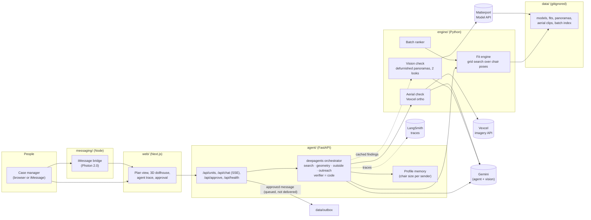

# Rollin'

Rollin' checks whether a specific wheelchair can get into the rooms of real apartments before anyone tours them.
A hospital case manager gives the chair's width and length and what the person needs (for example, "1 or 2 bedrooms
near the Texas Medical Center"). The fit engine then drives that chair through each apartment's measured floor plan, door by
door, and shows which rooms it reaches, which door stops it and by how much, and whether offset hinges would fix it.
An AI agent ranks the units, checks the building from aerial imagery and defurnished panoramas, and drafts questions
for the leasing office about anything the scan cannot answer. It sends nothing without a person's approval, and the
message says it comes from an AI.

Built at HackPrinceton Fall 2026 (CoStar track) by Aayush Deherkar and Aarohi Agrawal. Plan: `PLAN.md`. Rules for
coding agents: `CLAUDE.md`. API contracts and examples (synthetic data only): `contracts/`.

> **Real CoStar data is not in this repo.** CoStar's terms do not allow floor plans or property-identifiable data to be
> republished. Matterport models, the models index, aerial clips, panoramas and every result computed from them live
> only in gitignored folders (`data/cache/`, `data/raw/`, `data/batch/`, `data/replay/`, `data/outbox/`, `data/memory/`, `out/`). The repo's examples
> and tests use invented apartments. Real units are referenced by alias (`demo-main`, `demo-backup`, `demo-pass`,
> `demo-sparse`), mapped to model ids in the gitignored `data/demo_units.json`; get it from a teammate.

## Architecture



One live request: the orchestrator searches the ranked batch for the person's chair (re-checking the top candidates
live when the chair is not 27x42), drives the chair through the best units as scanned and with offset hinges, checks
the best building from aerial imagery, labels every claim's basis in code, drafts the leasing-office questions, and
pauses for approval. Every number the UI shows is `{value, unit, basis}` with basis `measured`, `estimated`,
`assumed`, `asked` or `unknown`.

## What it does, step by step
1. **Fit engine** (`engine/fit.py`). Walls and doors come from the Matterport wall graph (`floors.edges`, opening widths).
   - The chair is a rectangle of the person's width and length. The engine searches every reachable pose (x, y,
     heading) on a 5 cm grid with 16 headings. It starts in the room behind the unit's entrance door, or in the
     largest room if no exterior door is found.
   - Each room ends up `reachable`, `blocked` (with the door that stops the chair and the shortfall in inches) or
     `unknown` (no measured door, so we never call it failed).
   - It reruns with offset hinges on every door (about 1.75 in more clear width, an assumption) to show what that
     fix would change.
2. **Batch** (`engine/batch.py`). It ran the engine on every model within 20 km of the Texas Medical Center for a
   27x42 in chair:
   - 1,977 models processed. 892 had enough measured data to rank; 1,085 did not.
   - Of the 892, as scanned: 223 let the chair reach every room, 649 have at least one blocked room, and the other 20
     have no blocked room but at least one unknown room. These counts come from the batch index (`data/batch/index.json`,
     run on 14 Nov 2026).
3. **Agent** (`agent/agent.py`, deepagents). One request runs four model turns:
   - search, with the person's chair (for any chair other than 27x42, the batch's top 8 are re-checked live and
     re-ranked);
   - geometry (as scanned and with hinges) and the aerial outside check, in parallel;
   - the leasing-office draft;
   - a pause for approval.

   The verifier is plain code: it labels every claim's basis and turns unknowns into questions. If the model
   finishes without checking floor plans, the orchestrator checks the search's units itself and says so, so a live
   run always ends with a shortlist when anything matched.
4. **Vision** (`engine/vision.py`). For each bathroom and each blocked door, the nearest panorama of the unit's
   *defurnished* view goes to the vision model with fixed questions (bathtub or roll-in shower, grab bars,
   thresholds).
   - Each question is asked twice. An answer stands only if both looks agree; otherwise it is `unclear`.
   - Every answer cites its panorama and is labelled "from defurnished panorama, estimated".
5. **Outside** (`engine/vexcel.py`). An 80 m Vexcel orthophoto clip around the building is checked for accessible
   parking, curb ramps, walkways, exterior stairs and storeys, each answered yes, no or unclear and labelled "from
   aerial, estimated".
6. **Web** (`web/`). The plan view shows the chair's path and the door that stops it, plus a 3D dollhouse, a chair
   panel with presets, the agent's live trace, and the approval card. It also opens the Matterport tour at the
   blocking door.
7. **iMessage** (`messaging/`). A case manager can text the agent through Photon. The bridge replies with the top
   three units and asks before contacting anyone.

## Do chair sizes vary enough to matter?
Yes. `python -m engine.sweep` ran the fit engine on the 324 usable units within 8 km of the Texas Medical Center
(usable means at least one room has a measured boundary). It tried every chair width from 22 to 32 in, as scanned
and with offset hinges, and took 30 minutes on 10 processes with 0 failures.

**Length assumption:** chair length scales with width in the 27x42 in proportions (length = width x 42/27, rounded
to 0.5 in). "Fully reachable" means the chair reaches every room. A room behind an unmeasured door counts as not
reached, so these counts are lower bounds.

| Chair (in) | Fully reachable, as scanned | With offset hinges | Unlocked by hinges | No blocked room, as scanned |
|---|---|---|---|---|
| 22 x 34 | 154 | 201 | 47 | 176 |
| 23 x 36 | 140 | 175 | 35 | 162 |
| 24 x 37.5 | 136 | 144 | 8 | 156 |
| 25 x 39 | 134 | 138 | 4 | 154 |
| 26 x 40.5 | 124 | 134 | 10 | 142 |
| **27 x 42** | **112** | **130** | **18** | **128** |
| 28 x 43.5 | 97 | 115 | 18 | 111 |
| 29 x 45 | 89 | 104 | 15 | 100 |
| 30 x 46.5 | 58 | 93 | 35 | 65 |
| 31 x 48 | 19 | 80 | 61 | 22 |
| 32 x 50 | 4 | 43 | 39 | 7 |

- **Four inches of chair width more than halves the choice.** A 26 in chair gets into every room of 124 units, and a 30 in chair into 58. At 31 in only 19 units are fully reachable, and at 32 in only 4.
- **Hinges matter most at the two ends of the range.** At 31 in they take a chair from 19 fully reachable units to 80, and at 22 in from 154 to 201. Near 25 in they add only 4.
- **Which rooms block the 27x42 in chair** (as scanned, 324 units):

  | Room | Blocked | Share of rooms of that type |
  |---|---|---|
  | Closet | 229 of 540 | 42% |
  | Bathroom | 162 of 471 | 34% |
  | Bedroom | 46 of 491 | 9% |
  | Pantry | 29 of 38 | 76% |
  | Hallway | 15 of 210 | 7% |
  | Other | 14 of 47 | 30% |
  | Kitchen | 13 of 311 | 4% |

  Room types are the scan's own labels with the numbers removed.

- **Blocking doors** (385 distinct doors, estimated clear width): most are 20 to 22 in (136 doors) or 25 to 27 in (86 doors).
  - 14 of them are listed at 27 in or wider.
    - 3 of those 14 show as 27.0 in only because the estimate is rounded to 0.1 in; they are a fraction of an inch narrower than the chair.
    - The other 11 are wide enough, so what stops the chair there is the space around the door.
  - The full 1 in histogram is in `data/insights.json`.

`data/insights.json` holds these aggregates and nothing else: no unit ids, names or coordinates. `GET /api/insights`
serves it together with the sourced chair presets (see Sources).

## Data layers used
| Layer | Source | What we use it for |
|---|---|---|
| Wall graph, openings (door widths), rooms, dimensions | Matterport Model API (GraphQL), CoStar track | The fit engine: every reachable, blocked or unknown verdict |
| Defurnished view and its panoramas (6-face skybox) | Matterport Model API | Vision check of bathrooms and blocked doors |
| Matterport tour | Matterport Showcase (embedded player) | Opening the tour at the door that stops the chair |
| Models index (location, name, segment, floors) | CoStar hackathon kit (`models_index.csv`) | Finding units near the Texas Medical Center; bedroom counts from names |
| Orthophoto clips | Vexcel imagery API (`/v2/ortho/extract`) | Outside check of the building |

Everything fetched is cached under `data/` (gitignored), and the API and agent read only that cache while serving.

## How to run it
You need Python 3.11, Node 20.12 or newer, and keys for Matterport, Vexcel, the model provider and (optionally) LangSmith.
Put the keys in `.env`; the names are in `.env.example`. Never commit `.env`.

```bash
pip install -r requirements.txt
cp .env.example .env                 # fill in the keys
pytest -q                            # synthetic data only; the one real-data test skips without data/demo_units.json
```

**Data.** You can build it from the APIs. The last full Houston batch took 44 minutes:
```bash
python -m engine.matterport demo-main demo-backup demo-pass demo-sparse   # demo units (aliases)
python -m engine.batch --radius-km 20                                      # rank units around the Texas Medical Center (default 8 km)
python -m engine.vision demo-main demo-backup                              # panorama checks (cached)
```
Or unzip a teammate's offline demo pack at the repo root. Build one with `python -m engine.demo_pack`; it writes
`~/rollin-share/rollin_demo_pack.zip` and refuses to write inside the repo.

**One unit from the command line:**
```bash
python engine/fit.py demo-main            # 27x42 in chair; writes out/<id>_fit.json and a PNG
python engine/fit.py demo-main 25 40      # another chair (width, length in inches)
```

**API** on http://localhost:8000:
```bash
uvicorn agent.server:app --port 8000
```

| Request | Returns |
|---|---|
| `GET /api/units?lat=&lon=&radius_km=&beds=&w=&l=&hinges=` | The ranked list (`contracts/units_list.example.json`). `w`/`l` must be the batch chair (27x42); other sizes get a 422. |
| `GET /api/units/{sid}?w=&l=&hinges=` | The engine result for any chair (`contracts/unit_result.example.json`); 404 if the model is not cached. |
| `POST /api/chat` `{message, profile}` | A live agent run as an SSE stream (`contracts/chat_events.example.jsonl`); 503 until a model is configured. |
| `POST /api/chat?replay=1&speed=4` | A recorded run, every event marked `replay: true`. |
| `POST /api/approve` `{action_id, approved}` | The approval gate. Nothing outbound happens without it. |
| `GET /api/aerial/{sid}[/findings]`, `GET /api/vision/{sid}[/{pano_id}]` | Cached aerial and panorama evidence. |
| `GET /api/health` | Cached models, batch progress, what the demo units are missing, and `demo.main_sid` (with `backup_sid`, `pass_sid` and `sparse_sid`) from the alias file. |
| `GET /api/outbox`, `POST /api/outbox/{id}/delivered` | Approved messages waiting for the messaging bridge, and marking one as delivered. |
| `POST /api/answers` | A leasing office's reply. The unknown rooms it answers become `asked`; see `contracts/README.md`. |
| `GET /api/events` | An SSE stream of `delivered` and `answer` events, so the UI updates after a run has ended. |
| `GET /api/insights` | The chair-size sweep (aggregates only) and the sourced chair presets. |

To serve data from another folder, set `ROLLIN_DATA_DIR`.

**Preflight on the demo machine.** This checks the data, starts the API on a free port, and runs a replay. If a model
key is set, it also does a live run, which stops at the approval step, so nothing is sent. It prints one PASS, FAIL or
SKIP line per check. Everything except the live run works with no internet.
```bash
python -m agent.preflight                 # add --no-live to skip the live run, --url to check a running API
```

**Web app** on http://localhost:3000:
```bash
cd web && npm install && cp .env.example .env.local && npm run dev    # ROLLIN_API_URL=http://localhost:8000
```

**iMessage bridge** (optional; see `messaging/README.md` for Photon setup):
```bash
cd messaging && npm install && npm run console    # type as the case manager, no Photon needed
```

**One agent run from the command line:**
```bash
python -m agent.agent "27x42 in power chair, 1-2 bedrooms near the Texas Medical Center"
```

## The agent and its trace
- **Model.** `MODEL_PROVIDER` (`google` or `anthropic`) and `MODEL_NAME` from `.env`. We use `gemini-3.8-flash` for the
  agent and the vision checks, with thinking off.
- **Approval.** `send_message` is held by the orchestrator only and listed in deepagents' `interrupt_on`. The run
  pauses with an `approval_needed` event and continues only after `POST /api/approve`.
  - Every outbound text opens by saying it comes from an AI assistant.
  - An approved message is queued in `data/outbox/`. Nothing in this repo delivers it to a leasing office.
- **Memory.** The chair size is remembered per sender (a hashed id, never a phone number), so a later request
  without a size reuses it. The UI shows a `memory` event whenever this happens.
- **Speed.** One live request takes about 25 s and about 31k tokens. These are wall time and LangSmith token
  counts, measured on 14 Nov 2026 with a 27x42 chair and the fit cache warm. With a new chair size and no cached
  fits it took 29 s. An early version took 154 s and 142k tokens.

**Opening a LangSmith trace:**
1. In `.env`, set `LANGSMITH_TRACING=true`, `LANGSMITH_API_KEY` and `LANGSMITH_PROJECT` (ours is `rollin`).
2. Make a live request: the web app, `POST /api/chat`, or the command line above.
3. Open https://smith.langchain.com, go to **Tracing Projects**, and choose the project. Each request is one root
   run named **`rollin-chat`**.
4. To find a specific run, filter by metadata `run_id`. It equals the `run_id` on every event in the SSE stream.
5. Open the run to see the orchestrator's turns, each subagent (`search`, `geometry`, `outside`, `outreach`, and a
   read-only `general-purpose` helper when the model uses it), every
   tool call with its arguments and result, the approval interrupt, and token counts.

## Limitations
- **Door widths are measured by the scan, but the clear width is an estimate.** The engine subtracts 5 cm for the
  door leaf and stop. A door within an inch or so of the chair width needs a tape measure.
- **Walls only.** The wall graph has no furniture or fixtures, so the turning space in bathrooms and kitchens is an
  upper bound. Thresholds, steps and floor surfaces are not in the geometry at all.
- **Unknown stays unknown.** Some scans have only a few measured doors. Rooms behind an unmeasured opening are
  `unknown` and become questions for the leasing office, not verdicts.
- **Turning between headings is approximated.** The engine does not sweep the chair's corners as it rotates in
  place, so a very tight turn may be judged possible when it is not.
- **The offset-hinge gain (about 1.75 in) is an assumption.** It sits inside a hinge maker's stated range of 1.5 to 2
  in (see Sources), and it is not measured per door.
- **Ranking.** The batch is ranked for a 27x42 in chair. For other chairs, only the batch's top 8 candidates are
  re-checked live, so a unit that ranks low at 27x42 but well for a smaller chair can be missed.
- **Single-floor units only for vision.** Panoramas cannot be matched to a storey, so multi-floor units are not
  checked.
- **Vision and aerial answers are model estimates from images.** Two looks must agree for an answer to stand, but
  an answer can still be wrong. They are labelled as estimates and never upgraded from `unclear`.
- **No listing data.** We do not use rent, availability or CoStar listing records. Bedroom counts come from model
  names.
- **Outreach goes only as far as the bridge takes it.** Approved messages are queued in `data/outbox/`, and the API
  hands them to the messaging bridge (`GET /api/outbox`). The agent itself never delivers anything. A leasing office's
  reply (`POST /api/answers`) marks rooms `asked`, but it never changes the engine's verdict.
- **The demo runs from cache on one laptop.** Any replayed run is labelled as a replay.

## Sources
Each figure below was checked against the source on 14 Nov 2026. Figures we could not open and confirm are listed
at the end and are not used.

| Claim | Exact figure | Source |
|---|---|---|
| Minimum clear width of a door | "Door openings shall provide a clear width of 32 inches (815 mm) minimum." The width is measured between the face of the door and the stop, with the door open 90 degrees. | [2010 ADA Standards, 404.2.3](https://www.access-board.gov/ada/) |
| Turning space | A circle of 60 in (1525 mm) diameter minimum. | [2010 ADA Standards, 304.3.1](https://www.access-board.gov/ada/) |
| Clear floor space for one wheelchair | 30 in (760 mm) minimum by 48 in (1220 mm) minimum. | [2010 ADA Standards, 305.3](https://www.access-board.gov/ada/) |
| Wheelchair widths (measured users, not catalogue sizes) | Occupied width, chair plus user: manual chairs mean 685 mm (27.0 in), 95th percentile 786 mm (30.9 in), n=276. Power chairs mean 707 mm (27.8 in), 95th percentile 827 mm (32.6 in), n=189. "10-20% of individuals measured in our study have an occupied width that is greater than the U.S. standard of 760 mm (30 in.)" | [Anthropometry of Wheeled Mobility Project, Final Report](https://idea.ap.buffalo.edu/wp-content/uploads/sites/110/2020/01/AnthropometryofWheeledMobilityProject_FinalReport.pdf), IDeA Center for the U.S. Access Board, 31 Dec 2010, section 3.3.3 and Fig. 3-3 |
| Wheelchair lengths | Unoccupied device length: manual mean 1012 mm (39.8 in), 95th percentile 1264 mm (49.8 in). Power mean 1117 mm (44.0 in), 95th percentile 1340 mm (52.8 in). | Same report, section 3.3.2 and Fig. 3-2 |
| What offset (swing-clear) hinges gain | "typically adds about 1.5 to 2 inches of usable doorway width" | [Waterson (hinge manufacturer), swing-clear hinge page](https://watersonusa.com/solutions/swing-clear-hinge) |
| Which buildings the Fair Housing Act design rules cover | Buildings of 4 or more dwelling units with one or more elevators, and the ground-floor units of other buildings of 4 or more units ([24 CFR 100.201](https://www.govinfo.gov/content/pkg/CFR-2023-title24-vol1/xml/CFR-2023-title24-vol1-sec100-201.xml)). The rules apply "for first occupancy after March 13, 1991" (100.205(a)). Doors must be "sufficiently wide to allow passage by handicapped persons in wheelchairs" (100.205(c)(2)). | [24 CFR 100.205](https://www.govinfo.gov/content/pkg/CFR-2023-title24-vol1/xml/CFR-2023-title24-vol1-sec100-205.xml), CFR edition revised as of 1 Apr 2023 |
| Housing as a barrier to leaving nursing homes | "Twenty-five states reported finding affordable, accessible housing to be the number one barrier to transitions." | [KFF, Money Follows the Person: A 2015 State Survey of Transitions, Services, and Costs](https://www.kff.org/report-section/money-follows-the-person-a-2015-state-survey-of-transitions-services-and-costs-report/) (O'Malley Watts, Reaves, Musumeci, 16 Oct 2015) |

The chair presets in the app (`data/chair_presets.json`, served by `GET /api/insights`) are the mean and 95th
percentile manual and power chairs above, plus the 30x48 in ADA clear floor space. Their width is the occupied width,
because that is what has to pass a door.

**Not verified, so not used:**
- **Overall width of a bariatric wheelchair.** Only retailer listings were reachable, and they disagree (30 to 32.5 in
  for a 24 in seat). We found no manufacturer spec sheet, so there is no bariatric preset.
- **Manufacturer overall widths for particular manual and power models** (Invacare, Permobil). The product pages did
  not load for us, so we use the measured-user study above instead.

## What we built vs. what we used
**We built:**
- the fit engine: configuration-space search, door attribution, unknown handling, the offset-hinge what-if and the
  floor-plan renders;
- the Matterport client and caching, the batch ranker, the Vexcel and panorama checks with their fixed questions and
  two-look agreement;
- the deepagents orchestration, its tools and the code verifier, approval gating, profile memory, the SSE event
  contract and replay;
- the FastAPI server and the offline demo pack;
- the web app (landing page, plan view, 3D dollhouse, procedural manual and power wheelchair models, chair panel,
  agent trace, approval);
- the iMessage bridge.

**We used:**

| Area | Libraries and services |
|---|---|
| Data | Matterport Model API and Showcase, the CoStar hackathon kit (models index), the Vexcel imagery API |
| Models and agents | Google Gemini (`gemini-3.8-flash`) via langchain-google-genai, deepagents 0.7.38, LangChain 1.5, LangGraph 1.2, LangSmith |
| Python | NumPy, SciPy, Shapely, Pillow, Matplotlib, FastAPI, Uvicorn, Requests, python-dotenv, pytest, HTTPX |
| Web | Next.js, React, Tailwind CSS (with `@tailwindcss/turbopack`), tw-animate-css, shadcn/ui, Radix UI, class-variance-authority, cn, Motion, Lucide, three.js, React Three Fiber, drei, GSAP with ScrollTrigger and `@gsap/react`, Lenis (smooth scrolling on the landing page), TypeScript, ESLint with eslint-config-next, DefinitelyTyped type packages (`@types/node`, `@types/react`, `@types/react-dom`, `@types/three`) |
| Messaging | Photon 2.0 (`@photon-ai/api`), socket.io-client, tsx, TypeScript, `@types/node` |
| Fonts | Big Shoulders, Public Sans, IBM Plex Mono |
| Tools | git filter-repo (history scrub), GitHub CLI |

**AI-assisted coding (disclosure).** Most of the code in this repo was written with AI coding assistance: Claude Code
(Claude Opus 5.5), on both the Python side and the web and messaging side. Commits made with it carry a
`Co-Authored-By: Claude` trailer. We set the design and the rules in `PLAN.md` and `CLAUDE.md`, and reviewed every
pull request, including an automated code-review pass. We ran the tests and timed live runs, and checked results
against the real scans. The runtime AI (Gemini) is a separate thing: it is part of the product, and it is disclosed
above and in every message it drafts.
